# Awesome-Salary-Benchmarking 📊💼

  

  
  
  
  
  
  

## 🌐 Top Salary Benchmarking Tools Ecosystem

> 📌 **Curated Directory of SaaS Platforms & Open-Source GitHub Projects for Compensation Benchmarking, Pay Equity Analysis, Real-Time Market Data, Salary Band Modeling, and Total Rewards Architecture.**

**Last updated: August 2026**

---

### 📖 Overview

This repository tracks notable **SaaS platforms** and **open-source projects** for **Salary Benchmarking** and **Compensation Intelligence**. These tools provide market compensation data, real-time or survey-based benchmarks, pay band design, equity analysis, job leveling, and total rewards insights to help organizations set competitive and equitable pay.

* **Enterprise & SaaS Leaders:** Includes category benchmarks like Radford McLagan (Aon), Comptryx (Mercer), Pave, Payscale, Salary.com, OpenComp, Figures, and ERI.
* **Open-Source & Developer Ecosystem:** Contains tools for internal pay transparency, community compensation trackers, H-1B visa salary databases, leveling frameworks, and open wage statistical pipelines — ideal for HR teams, compensation analysts, startups, and developers seeking greater transparency and control over pay data.

Contributions welcome! Open a PR to add or update entries.

---

## 📑 Table of Contents

- [🏢 SaaS & Hosted Platforms](#-saashosted-platforms)
- [🔓 Open-Source GitHub Projects](#-open-source-github-projects)
- [📈 Star History](#-star-history)
- [🤝 How to Contribute](#-how-to-contribute)
- [⚠️ Disclaimer](#-disclaimer)

---

## 🏢 SaaS/Hosted Platforms

*Sorted by Company Size / Valuation / Revenue (Descending)*

| Product | Description | Starting Price | Free Tier / Free Trial Limits | Company Size / Valuation / Revenue |
| :--- | :--- | :--- | :--- | :--- |
| **[Radford McLagan (Aon)](https://radford.aon.com/)** | 🏆 Premier compensation database and survey platform especially strong in technology, life sciences, and financial services roles. | Single survey subscriptions start at **$15,000 – $40,000/year** (data participation model) | **No free tier or free trial**; operates on a "give-to-get" data participation model with discounted access for survey contributors. | **~$75B Market Cap** / ~$15B+ Annual Revenue (NYSE: AON) |
| **[Comptryx (Mercer)](https://www.comptryx.com/)** | 🌐 Global compensation benchmarking and analytics platform supporting market pricing and total rewards insights across global workforces. | Subscriptions start at **$8,500/year** (varies by headcount and number of countries) | **No free tier or self-serve trial**; free guided product demo available through Mercer representatives. | **~$100B+ Parent Market Cap** (Marsh McLennan, NYSE: MMC / Mercer division) |
| **[Pave](https://www.pave.com/)** | 🦄 Modern compensation platform offering real-time benchmarking via HRIS integrations, pay planning, offer tools, and market data for tech companies. | Free tier available; paid plans start at **$7 – $20/employee/month** (custom quote-based) | **Free forever** via Market Data Lite for companies with **<=200 employees** (covers US + 1 additional market, 200+ job families). | **$1.6B Valuation** (Series C Unicorn) / ~$31M ARR |
| **[Payscale](https://www.payscale.com/)** | 📊 Established compensation data and software provider with extensive survey-based market pricing, job matching, and analytics tools. | Paid tiers (Basics) start at **$12,000 – $35,000/year** (custom quote based on headcount) | **Free tier via Payfactors Free** allowing pricing for up to **10 jobs/year** (plus free web-based "Price a Job" reports). | **$325M+ Valuation** (Acquired by Francisco Partners) / ~$170M+ Annual Revenue |
| **[Salary.com](https://www.salary.com/)** | 📈 Comprehensive compensation platform featuring CompAnalyst for market data, salary structures, job pricing, and AI-assisted workflows. | Individual reports start at **$220 – $245/job report**; enterprise software starts at **~$10,000+/year** | **14-day free trial** for CompAnalyst Market Data (requires work email/company verification); no ongoing free tier. | **$100M – $220M+ Revenue Range** (H.I.G. Capital portfolio) |
| **[CompAnalyst (Salary.com)](https://www.salary.com/)** | 🎯 Mature market-pricing and benchmarking tool within Salary.com for structured salary bands, analytics, and enterprise compensation management. | Single job market reports start at **$245/report**; full enterprise subscription starts at **~$10,000+/year** | **14-day free trial** available for CompAnalyst Market Data module; no permanent free tier. | **Part of Salary.com** (~$100M – $220M+ revenue ecosystem) |
| **[OpenComp](https://www.opencomp.com/)** | 💡 Compensation decision software with real-time crowd-sourced/HRIS data, benchmarking, merit cycles, and pay strategy tools. | Paid benchmarking starts at **$4,500/year** (Comp Strategy at $8,500/yr, Comp Cycles at $15,000/yr) | **14-day free trial** with no credit card required, plus free access to PayChecked salary calculator & selective benchmark data. | **~$25M Funding Raised** / ~$5M – $12M ARR |
| **[ERI (Economic Research Institute)](https://www.erieri.com/)** | 🔍 Long-standing provider of salary survey data, geographic differentials, and compensation analytics for a wide range of roles and locations. | Subscriptions for Salary Assessor start at **~$2,500/year** (quote-based package) | **No free tier or standard trial**; offers a free self-guided platform demo with limited sample dataset and free survey participant reports. | **~$27M – $30M Est. Valuation** / ~$10.2M Annual Revenue |
| **[Ravio](https://ravio.com/)** | 🚀 Real-time European and global tech compensation benchmarking with employer-sourced data, pay equity features, and salary band management. | Paid plans start at **GBP 5,000/year** (custom quote based on headcount & modules) | **Free tier limited to 3 free benchmarks** for user-selected roles (no full-platform free trial). | **~$22M Funding Raised** / ~$8.2M ARR |
| **[Figures](https://www.figures.hr/)** | 🇪🇺 European-focused compensation management and benchmarking solution with strong support for EU Pay Transparency Directive compliance. | Paid plans start at **EUR 2,500/year** (or **EUR 500/month**) based on employee count | **Free trial available upon request / demo** (typically 7–14 days for platform evaluation); no permanent free tier. | **~$8M+ Funding Raised** (Point Nine, Seedcamp, Bpifrance) |

---

## 🔓 Open-Source GitHub Projects

*Sorted by GitHub Star Count (Descending)*

- **[awesome-remote-job](https://github.com/lukasz-madon/awesome-remote-job)**   
  🌍 Curated list of remote companies, job boards, and resources including transparent compensation practices and global remote salary standards.

- **[remote-jobs](https://github.com/remoteintech/remote-jobs)**   
  🏢 Community list of semi to fully-remote-friendly tech companies with transparent tags for competitive global compensation policies.

- **[open-salaries](https://github.com/sizovs/open-salaries)**   
  📢 Curated collection of companies, case studies, and resources promoting transparent, formula-driven, and open salary policies.

- **[CeleryBand](https://github.com/maybeanerd/celeryband)**   
  🌱 Open-source platform for anonymous internal salary sharing and comparison within an organization to promote pay transparency and fair compensation awareness.

- **[Academic & ML Salary Benchmarking](https://github.com/ApexPredictors/COMP6940-Project)**   
  🔬 Interpretable machine-learning framework for cross-country salary prediction, wage anomaly detection, and fairness analysis using open datasets.

- **[Compflow](https://github.com/Dogukkanx/compflow)**   
  ⚙️ Open-source compensation workflow tool focused on salary bands, approval cycles, and pay equity insights for EU Pay Transparency compliance.

- **[Comp Pulse](https://github.com/jschulman/comp-pulse)**   
  📈 Open-source dashboard tracking directional compensation trends (index-based, not absolute salaries) from public job-board data.

- **[levels.fyi Scrapers & Data Tools](https://github.com/ishandutta2007/Awesome-Salary-Benchmarking)**   
  🛠️ Community scripts, scrapers, and data transformation tools to extract and analyze publicly available tech compensation benchmarks and level-mapping data.

- **[H-1B Salary & LCA Disclosure Pipelines](https://github.com/ishandutta2007/Awesome-Salary-Benchmarking)**   
  🏛️ Public Department of Labor (DOL) LCA and H-1B visa wage data parsers for prevailing wage analysis across tech hubs.

- **[BLS & Government Open Wage Data Pipelines](https://www.bls.gov/)**   
  📊 Extraction scripts and ETL workflows for U.S. Bureau of Labor Statistics Occupational Employment and Wage Statistics (OEWS).

- **[Internal Pay Transparency Calculators](https://github.com/ishandutta2007/Awesome-Salary-Benchmarking)**   
  🧮 Community implementations of formula-based, band-based open salary calculators inspired by open compensation standards (such as Buffer and GitLab models).

---

### 📦 Additional Strong Open-Source Resources & Recipes

* 📊 **Public Dataset Archives:** Levels.fyi community datasets, Kaggle Data Science Salary Surveys, Stack Overflow Annual Developer Surveys, and government labor statistics.
* 📋 **Pay Band Design Templates:** Open spreadsheet models and relational databases for constructing salary bands, midpoint progression, and spread ratios.
* ⚖️ **Pay Equity Analysis Notebooks:** Python/R Jupyter notebooks evaluating gender and ethnic wage gap distributions using standard statistical fairness metrics.
* 🔌 **HRIS API Connectors:** Open webhook and API integrations for synchronizing internal employee leveling data with private compensation databases.

---

## 📈 Star History

<a href="https://www.star-history.com/?repos=ishandutta2007%2FAwesome-Salary-Benchmarking&type=date&legend=bottom-right">
<picture>
<source media="(prefers-color-scheme: dark)" srcset="https://api.star-history.com/chart?repos=ishandutta2007/Awesome-Salary-Benchmarking&type=date&theme=dark&legend=bottom-right" />
<source media="(prefers-color-scheme: light)" srcset="https://api.star-history.com/chart?repos=ishandutta2007/Awesome-Salary-Benchmarking&type=date&legend=bottom-right" />

</picture>
</a>

---

## 🤝 How to Contribute

1. 🍴 Fork the repository.
2. ✏️ Add or edit entries in `README.md` following the existing format.
3. 📝 Include: name, link, star badge (for repos), pricing/valuation details (for SaaS), and a concise description.
4. 🚀 Submit a Pull Request with a short summary of changes.

---

## ⚠️ Disclaimer

* This repository is a **community-curated** directory — not exhaustive and not an endorsement.
* Compensation data quality varies significantly by source (employer-reported vs. self-reported vs. public job postings). Always validate sample size, methodology, and recency before making compensation decisions.
* Organizations implementing self-hosted pay systems must adhere to relevant privacy and employment regulations (GDPR, CCPA, EU Pay Transparency Directive).

---

  <b>Built for People Operations, Total Rewards Leaders, Compensation Analysts, and Advocates of Fair & Equitable Pay.</b>

